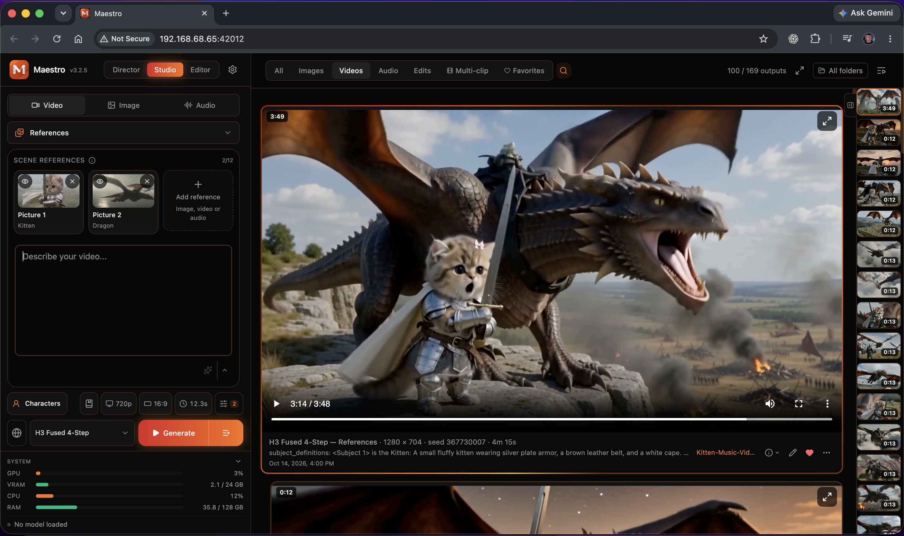

# Maestro

A one-click local AI **creative studio, director, and video editor** for creators. Maestro combines a modern interface with powerful image, video, and audio generation, an LLM-directed production workflow, and a non-destructive multi-track editor. Optimized for LTX-2.5, MiniMax H3, and the latest local creative models and LoRAs.



[Features](#what-it-does) · [Install](#install) · [Updates](#updates) · [Guides](docs/README.md) · [Full update history](docs/UPDATE_HISTORY.md)

## What it does

Create with **Studio**, plan a production with **Director**, and finish it in the **Editor**. Local models run on your own PC; external AI services and private remote access are optional.

### Create, direct and edit

- **Director — music videos and short films.** Turn a song or story into a shot plan, prepare character references and keyframes, generate the clips, and assemble the result. Use Auto mode for a complete production or Manual mode to review each stage. The project dashboard keeps plans, prompts and takes together so you can revise individual shots. [Director guide](docs/Director-controls.md).
- **Studio — video, images and audio.** Generate from text or references; animate, extend, blend and edit video; create and edit images; or make music, speech, cloned voices and sound effects. Queue jobs, enhance prompts and adjust model-specific controls. Models include MiniMax H3, LTX, Flux, Qwen, MOSS and Fish Audio. [Studio guide](docs/Studio-controls.md).
- **Editor — finish on a timeline.** Arrange video, audio and titles with trimming, transitions, speed, volume and canvas controls. Bring in a Director production or gallery clips, send a shot back through AI generation, and export the finished edit.

### Keep control of your creative workflow

- **Reusable characters and references.** Save and share characters with appearance references and optional voices. Combine image, video and audio references in supported workflows to guide identity, action and sound. [Characters and RefMods](docs/Maestro-Characters.md).
- **Built-in AI writing.** Local language and vision models help develop prompts and plan productions, with models downloaded on first use. Optional external providers include OpenAI, Anthropic and compatible local endpoints such as LM Studio. [Local AI guide](docs/LLM-runtime.md).
- **Models and LoRAs in one place.** Browse compatible CivitAI LoRAs and community checkpoints, manage downloads and updates, and use prompting guides and recommended strengths. [H3 checkpoint imports](docs/H3-checkpoint-import.md).
- **Performance matched to your PC.** Auto-Tune uses your GPU, VRAM and RAM to choose starting settings. Quantization, memory offloading and duration recommendations help smaller GPUs, while advanced controls remain available. [Performance guide](docs/Performance-auto-tune.md).
- **An organized library, wherever you work.** Separate projects into workspaces, search across folders, save favorites and reload generation settings. Use the responsive interface on a phone or tablet, with optional completion alerts and private Tailscale access to your running PC. [Remote access and notifications](docs/TAILSCALE_REMOTE_ACCESS.md).

Available inputs, editing tools and acceleration depend on the selected model and hardware. See the [guides and model details](docs/README.md) for workflows, setup and model-specific licenses.

## Updates

[View the complete update history](docs/UPDATE_HISTORY.md) · [Detailed changelog](CHANGELOG.md)

The version you are running is shown next to the Maestro title in the UI. To update, use the launcher's Update button in Pinokio.
Runtime upgrades are explicit menu actions. A missing performance-runtime marker
does not automatically run Update when you open the launcher. If offered,
**Start with Compatibility Runtime** keeps the existing runtime available.

### v4.0.0 (2026-10-29–30) — Dev release candidate

The next major Main release is being prepared on **Dev** as v4.0.0.

- **A fresh appearance:** first opening v4 switches to Graphite Studio in Dark
  mode, including browsers with a saved theme. This happens once; choose another
  theme or appearance in Settings afterward and that choice stays saved.
- **An upgraded Editor and animated titles:** a fuller editing workspace,
  reviewable Auto-edit plans, chroma key and transparent MOV export; titles can
  also be generated directly in Studio.
- **New creative models and tools:** MOSS reference editors, Fibo 2.0, H3
  accelerators/PTD/two-pass options, FlashVSR+ Turbo and experimental Pika H3
  Flex with motion/audio sliding windows. Flex is enabled in the default Frames
  and References lists. Worlds and Profile 0 remain optional experimental tools.
- **Smoother daily use:** compact pinned Studio controls, clearer startup and
  mobile loading, resizable thumbnails, image-workflow fixes and quieter logs.

The existing Dev updates are included. See the
[v4.0.0 candidate notes and testing limits](docs/RELEASE_NOTES_V4.0.0.md).

### v3.3.0 (2026-10-26) — Dev testing

- **Qwen Image 2.1 reference caching:** optional INT8 caches in VRAM or system
  RAM, with memory guards and separate positive/negative guidance caches.
  Disabled remains the default; RAM transfers can trade speed for lower VRAM.
- **H3 LightX2V accelerators:** four new workflow-matched four/eight-step
  presets, with pinned weights and their correct video sampling shifts.
- **FlashVSR+ Turbo:** a separate upscaler in Post Processing, Tools and Editor.
  Existing FlashVSR selections keep v1.1 and its original behavior.
- **Optional kernel updates:** compatible WGPKernels 1.4.2 and GGUF CUDA
  1.0.29 installers, with hash-pinned downloads and existing fallbacks.

Available on **Dev for testing**; Main remains v3.2.5. Update the idle Dev
installation in Pinokio, restart Maestro and refresh the browser. CPU tests
and the UI build passed. Functional GPU checks now cover the RTX 4090, 12GB
RTX 3080 Ti and 8GB RTX 5070 Laptop. Follow-up fixes restore v1.1 sparse
attention and load the official Plus checkpoint names correctly; all 12 latest
FlashVSR image/video checks passed. These bounded checks are not a matched
speed or general quality benchmark. See the
[v3.3.0 Dev release notes](docs/RELEASE_NOTES_V3.3.0.md).

### v3.2.5 (2026-10-24)

- **Faster Fish speech:** whole-frame CUDA Graph decoding when the full model
  fits, cached experts and partial acceleration for smaller GPUs, and compatible
  RTX 30-series attention. Add **Fish Drama 3 Small** with voice references and
  streaming synthesis assembled into one gallery audio file.
- **Long-form speech writing:** saved style/personality instructions, draft
  targets based on the selected duration, bounded section writing and recovery,
  richer Fish performance cues, and retained incomplete drafts with clear reasons.
  Fish Auto length lets the script finish naturally within safety limits.
- **H3 checkpoints and memory:** support Eros Max beta5/beta6 mixed layouts,
  share compatible imports across Frames and References, and correct Auto-owned
  H3 placement on Windows 16GB RTX 50-series / 64GB RAM systems.
- **Director recovery:** repair repeated source-action allocations and missing
  physical-continuity metadata without rewriting accepted shot content. Fix
  concurrent Windows soundtrack-cache publication.

Available on **Main and Dev**. Update the idle installation in Pinokio,
restart Maestro and refresh the browser. Short Fish tests completed on 24GB,
12GB and 8GB GPUs; speed and delivery depend on hardware and the script. The
reported RTX 5080 regression still needs a matched hardware comparison.
See the [v3.2.5 release notes](docs/RELEASE_NOTES_V3.2.5.md).

### v3.2.0 (2026-10-22)

- **Startup and mobile:** prioritize model controls, recover interrupted startup,
  keep mobile controls visible without a refresh, and show workspace loading
  continuously while the saved folder and gallery are restored.
- **Director and H3 references:** improve source-action extraction, outline
  compatibility and style handoff; retain rejected writer drafts with reasons,
  preserve accepted multi-window prompts during repairs, and add explicit video
  soundtrack roles in Studio and Director. Repair Animate trim bounds and H3 VDN,
  Music3 and local-writer downloads. [Audio and drafts](docs/H3-Reference-Audio-and-Drafts.md).
- **21 October fixes:** multi-window Face Refiner blending, visible warnings
  when optional finishing fails, native DLSS availability checks, large-input
  WGPKernels preparation, preserved manual INT8 choices during Auto-tune, and
  external-LLM Director music-arc response compatibility. The Qwen processor
  download repair is also verified against the current public asset pin.
- **FastH3 V2:** experimental eight-step text-to-video with generated audio,
  trained VSA-H3 attention and its own sampling recipe.
- **FastH3 OmniRef:** experimental eight-step video/audio generation from ordered
  image, video and audio references. Official BF16, INT8 and FP8 options, plus a
  separate Blackwell QAD NVFP4 model. [FastH3 guide](docs/FastH3.md).
- **Qwen Image 2.1:** repair processor downloads and reduce final VAE decode
  memory; improve overlapping tiles to address thin boundary lines in
  lower-memory decode modes. [Qwen guide](docs/Qwen-Image-2.1.md).

Available on **Main and Dev**. Update the idle installation in Pinokio,
restart Maestro and refresh the browser. New FastH3 variants remain experimental;
consumer real-time speed and complete renders with the new BF16/FP8/NVFP4 formats
are not yet verified. See the [v3.2.0 notes](docs/RELEASE_NOTES_V3.2.0.md).

### v3.1.0 (2026-10-19)

- **MOSS Image 5B Base and SFT:** text-to-image generation, a visual layout helper
  with character, multi-panel and collage options, and model-specific prompt
  enhancement with validated coordinate conversion. Public BF16/INT8 downloads;
  SFT is enabled once in the image picker. [MOSS guide](docs/MOSS-Image.md).
- **H3 community checkpoints:** accept compatible mixed-precision exports,
  preserve retained FP32 layers, request missing QKV layout information and
  distinguish optional Turbo LoRA recipes from the checkpoint's base settings.
- **H3 References compatibility:** generation and enhancement accept explicitly
  declared legacy speaker labels and reuse established speakers within a clip.
  Shot/scene headings cannot become character names; identities and voices stay
  paired independently of their numeric labels.
- **FLUX 3 Klein and MOSS LoRAs:** compatible adapter loading, per-step
  multiplier schedules and matching Civitai browser filters.
- **Krea 2 Turbo imports:** recognize its Civitai label and supported NVFP4
  checkpoint layouts while retaining compatibility validation.
- **H3 VAE x2, Viggle Animate and Refine faces:** repair missing upstream asset
  revisions; fix a second pixel conversion that washed out refined faces.
- **Recast RAM use:** release tracking arrays before generation and record
  useful workload and memory diagnostics. The reported RTX 4080 runtime remains
  unverified without its original settings/logs.

Update your **Main or Dev** installation in Pinokio while idle, restart Maestro and
refresh the browser. See the
[v3.1.0 release notes](docs/RELEASE_NOTES_V3.1.0.md) and
[workflow troubleshooting](docs/V3-Workflow-Fixes.md).

### v3.0.0 (2026-10-18)

- **WanGP 17 memory engine:** bundled MMGP 4, optimized VRAM allocation, smart pinning, dynamic preload, optional RAM allocation and Windows read-ahead controls. Compatible attention, INT8 and VAE paths reduce memory overhead; saved manual preferences remain in control.
- **Generation-aware Auto-tune:** uses the GPU, system RAM, resolution, window length and references to choose temporary H3 placement. Bounded local comparisons can teach it a faster safe placement. Includes conservative recommendations for smaller-memory machines.
- **Hardware-aware clip defaults:** Studio and Director share H3 duration recommendations. The tested 8-GB / 32-GB Fused tier starts at 10.1 seconds at 720p; the 12-GB / 32-GB Pruned and Fused tier starts at approximately 14.4 seconds. Native 1080p remains conservative on smaller cards. Saved manual durations stay in control.
- **Measured release improvements:** matched short 720p H3 Fused References tests used 37–39% less active generation time on the 4090 and 52–72% less on the 3080 Ti. All six Dev laptop tests completed; a separate 5.2s Main/Dev reload comparison took 24m36s versus 4m48s. [Benchmark methods and limits](docs/BENCHMARKS_V3.0.0.md).
- **Experimental H3 sparse attention:** opt-in SLA for Full/Pruned and Veda for Full/Pruned/Fused in Frames and References. Veda downloads verified learned predictors on first use; Fused retains its default SLA recipe. Compatible 3080 Ti SageAttention jobs also use shorter temporary-buffer lifetimes.
- **Simpler model selection:** grouped Video, Image and Audio settings, workflow-specific model visibility, concise names, compact download controls and a reset that preserves downloaded files. New Director projects default to H3 Fused 4-Step References, and song analysis returns users to reference setup.
- **Qwen Image 2.1 Turbo:** optional native eight-step image generation and editing with the official Turbo schedule, compatible LoRAs and verified BF16/INT8 assets. [Qwen guide](docs/Qwen-Image-2.1.md).
- **Flux 3 Klein 5.6B:** Distilled 16-step and Base 50-step image generation/editing with up to ten references, BF16/INT8 options and public on-demand downloads requiring no Hugging Face login. Prompt Helper draws layout boxes and reference edits; dedicated enhancement guides preserve ordered reference bindings and supplied layout data. NVFP4 requires supported RTX 50 hardware. [Flux 3 guide](docs/Flux-3-Klein.md).
- **New local writer and experimental MTP:** Underdog Saluki 27B IQ2-Mix Uncensored with vision support, plus a default-off MTP acceleration option for compatible local writers.
- **Fused checkpoint labels:** Frames and References now appear as **H3 Fused 4-Step**, without the Experimental suffix. Both continue to share the same verified upstream weights.
- **H3 VAE 2×:** optional learned video decoding doubles both output dimensions while denoising at the selected resolution. Available in Studio and Director; its verified 2.8-GB decoder downloads on first use. [H3 VAE guide](docs/H3-VAE-x2.md).
- **Faster H3 setup and repeated work:** download auxiliary tools when needed, reuse eligible plain-text conditioning, and batch compatible VAE tiles within memory limits. Director uses Studio's hardware-aware encoder recommendation, including Q2_K on constrained machines.
- **Director live previews:** discover previews as clips start, combine progress and preview in one tile, and retain whole-project Stop and ETA. Tap/click a preview to hide or restore its information overlay; playback controls remain separate.
- **Gallery video durations:** see clip lengths on cards and side thumbnails before pressing Play, while retaining reliable image posters and lazy video loading on desktop and mobile.
- **Director gallery groups:** keep source shots collapsed beneath the latest final video. Expand clips to browse them, edit Director shots, and rejoin current takes into a new final while retaining earlier outputs.
- **More reliable prompt enhancement:** allow longer CUDA writer startup, distinguish device-probe timeouts, expose dialogue validation reasons, and shorten AI-written exchanges to fit the selected duration while preserving speakers and user-supplied lines.
- **Director prompt fixes:** preserve multiline prompts in single-shot music videos and carry the selected H3 encoder through generation, regeneration, repair and resume. Music-video planning preserves completed shots and repairs incomplete batches in smaller requests; unrecoverable plans stop before rendering instead of repeating the overall story.
- **Whole-song direction and optional lyric context:** plan visual progression across the song, keep requested actions in order and repair repeated actions without replacing accepted neighboring shots. **Use lyrics to guide visuals** is off for new projects; soundtrack timing and assigned lip-sync remain available either way.
- **Safer Director editing and clip comparisons:** retain per-shot prompt drafts through deselection and failed reruns, identify errors beside the affected shot, and prevent unambiguous reference aliases from creating duplicate subjects. An individual clip's pencil restores its own recipe into Studio, including its original window size; the joined video reopens the full Director project.
- **Optional developer test bench:** manual diagnostics, prompt/render regressions, cold/warm comparisons and multi-machine report collection, plus Windows SSH setup and bounded diagnostics. Test results remain local; no recurring schedule is installed.
- **YuE2 download repair:** verified replacement asset revision restores music generation after upstream repository-history changes.

This release supersedes the unreleased v2.7.0 candidate. Use **Update**
in Pinokio on Main or Dev while idle,
restart Maestro and refresh the browser. Existing installations with Auto-tune
enabled receive the revised recommendations once at startup; saved manual choices
are preserved. **Settings → Performance → Re-detect** can explicitly reapply
recommendations. Check the active allocator and restart if an allocator change
is pending.

See the [complete changes](docs/RELEASE_NOTES_V3.0.0.md),
[validation and remaining checks](docs/VALIDATION_V3.0.0.md), and
[Auto-tune guide](docs/Performance-auto-tune.md). Measured improvements depend on
the workload and hardware. The 8-GB laptop results cover selected workflows with
32 GB RAM; 6/10-GB GPUs, 16 GB RAM and Linux CUDA generation remain unverified.

### v2.6.0 (2026-10-04)

- **Live generation previews:** looping Tiny VAE video is enabled by default in Studio, with Fast Frames, Clearer Frames and Off also available. Includes pause/resume, phone playback, selected-model support labels and still previews for supported image models. Saved preview choices are preserved. H3 previews use the predicted clean result during denoising. [Preview guide](docs/Generation-preview.md).
- **Community H3 checkpoint imports:** compatible BF16/FP16, scaled FP8, INT8 ConvRot, W4A8 INT4 and GGUF checkpoints register native Frames and, when supported, References entries. Includes standard/Turbo/fused recipes, tensor-layout and SHA-256 verification, installed-weight reuse and Eros Max header-INT8 compatibility. [Import guide](docs/H3-checkpoint-import.md).
- **DaSiWa checkpoint support (#167):** download compatible checkpoints through the Model Browser instead of built-in DaSiWa selections. Verified H3 Hybrid v3 imports retain standard/baked-Turbo recipes and paired Frames/References workflows. [Model guide and family limits](docs/DaSiWa-models.md).
- **Singularity across video workflows:** experimental Frames and References entries support text, start/end/timed images, Control Video editing and ordered references, sharing the existing v1.3 checkpoint and recommended adapter. [Usage guide](docs/H3-Singularity.md).
- **LongCat Avatar:** a dedicated Avatar workflow below References, anchor/voice and two-speaker controls, corrected multi-speaker/audio-window routing, native window defaults and lower peak activation memory use.
- **Long source timelines:** Frames control videos/masks and H3 reference videos/soundtracks advance with each window. Auto duration follows timeline reference videos; character and voice samples remain reusable. [Studio controls](docs/Studio-controls.md#long-source-media-across-windows).
- **Object and sound-effect references:** preserve a prop's design without treating it as a character, or reuse a short effect sample in each window to guide matching generated sound.
- **Clearer duration planning:** Window keeps the selected count and updates total duration as Window Length changes, including experimental 30s H3 windows. Time keeps the total runtime; Auto follows the prompt or source. H3 guidance separates normalization speed estimates from GPU memory recommendations and marks the 14.4s recommended boundary.
- **H3 performance (#152):** native RMSNorm through 75,000 ordinary packed rows, bounded normalization for larger workloads, and explicit overrides. DaSiWa and compatible imported Turbo checkpoints support the configured dense backend and optional Sol Engine without adding another accelerator.
- **H3 prompt fidelity:** preserve eligible long locked action passages, repair failed camera cards with more precise feedback, bound semantic reviews, reduce camera-language/identity false positives, reject unclosed spoken quotes and preserve entrances in reference fallbacks.
- **Download cancellation and quieter status (#156):** separate enable/download actions, Cancel and Retry controls, safe cleanup, change-waiting status and hidden-tab suspension with compatibility fallback.
- **Gallery reliability:** thumbnail clicks stay with the intended asset while metadata loads, the thumbnail strip follows selection, action menus fit the viewport and video inputs display posters.
- **Runtime fixes:** explicit LM Studio model-memory controls, NVIDIA compute utilization, clearer Windows startup failures, correct failure status for skipped generation tasks and guarded INT8 kernel retries. MMGP is pinned to 3.8.2.

Use **Update** in Pinokio, restart Maestro and refresh the browser. See the
[complete release notes](docs/RELEASE_NOTES_V2.6.0.md) and
[validation scope](docs/VALIDATION_V2.6.0.md).

### v2.5.0 (2026-09-28)

**LoRA improvements, Qwen Image 2.1 tools, gallery playback and editing, and Windows 10 DLSS**

Includes the v2.4.1 and v2.4.2 updates below.

- **Readable LoRA names:** creator titles and editable display names across Studio, Director and My LoRAs, with version/variant labels and stable release/download dates. Original files and update tracking stay intact.
- **LoRA-aware enhancement:** active adapters' guides and trigger words reach the prompt writer, including H3 Frames and References. Downloads save available creator guidance automatically without loading an LLM.
- **Broader H3 LoRA support:** load compatible CivitAI adapters that use flattened module names, while retaining checks for incompatible or ambiguous weights.
- **Gallery slideshow:** automatically advance after each video, choose 1–10 seconds per image, and transition with the same upward swipe. Viewer controls fade during playback and return when tapped.
- **Sharper previews and easier uploads:** responsive video posters up to 1920 pixels, plus a fix for Frames image selections disappearing after the mobile photo picker closes.
- **H3 window timing:** preserve multi-window timing from Enhance through Generate (#160).
- **Use gallery audio:** send songs, soundtracks and voice samples directly to compatible inputs in the active sidebar, including Director, Studio references, Speech, Revoice and YuE2.
- **Trim before using:** choose an audio or video excerpt with a waveform or filmstrip, draggable handles, exact times and quick 3/5/10-second selections. Preview or zoom into the range, or use the full clip. Originals stay unchanged.
- **Krea Identity Edit:** Subject likeness, separate Scene likeness for two references, and Grounding resolution for RAW and Turbo. Settings persist per model and travel with queued jobs, presets and output settings.
- **Krea reference fixes:** preserve native reference proportions before grounding, fit reference latents without stretching, and hide Turbo's ineffective guidance control while keeping RAW guidance adjustable.
- **Qwen Image 2.1:** pose/depth/edge transfer, inpainting, LanPaint, outpainting, native **2K** presets, optional reference KV caching, and managed **Viggle Turbo** 4/5/6-step profiles. Updated prompt guidance, base settings and VAE tiling; fixed the inpainting-mode error on ordinary image generation.
- **H3 and LTX performance:** automatic H3 INT8 ConvRot video VAE selection with INT8 transformers, plus optional Comfy Kitchen kernels on supported RTX 50 hardware with compatibility fallbacks.
- **Windows 10 DLSS — Experimental:** optional 1x neural enhancement and 1.5x/1.724x/2x/3x upscaling for images and videos. Improved frame processing, audio preservation and worker cleanup. Requires a separate opt-in installation. DLSS Frame Generation is also available on supported Windows 10 systems after its separate installation and hardware/worker capability checks. [Setup guide](docs/DLSS5.md).
- **Gallery ordering:** keep results in chronological order during generation, refresh and pagination, while retaining the selected item (#155).
- **Media Info:** timestamps, measured resolution and file details, plus finishing method, scale, before/after resolution and frame rate, source and processing time when available.
- **Upload cleanup:** delete uploaded media from the gallery with confirmation and protection for inputs used by active jobs.

Use **Update** in Pinokio, restart Maestro and refresh the browser. Your existing projects, settings and media stay in place. Optional model assets download when first used; the Windows 10 DLSS backend requires explicit installation.

[Full v2.5.0 release notes](docs/RELEASE_NOTES_V2.5.0.md) · [Validation and remaining limits](docs/VALIDATION_V2.5.0.md) · [Changelog](CHANGELOG.md)

Included update details: [v2.4.2 release notes](docs/RELEASE_NOTES_V2.4.2.md) and [validation](docs/VALIDATION_V2.4.2.md); [v2.4.1 release notes](docs/RELEASE_NOTES_V2.4.1.md) and [validation](docs/VALIDATION_V2.4.1.md).

### v2.4.0 (2026-09-24)

**Immersive gallery, Qwen LoRA improvements, H3 Singularity, and better prompt-enhancement control**

- **Fullscreen gallery:** enlarge images and browse images/videos with vertical swipes, keyboard navigation and favorites. Tap to pause or play, keep your sound choice across clips, and pinch to zoom images. Prepared video transitions and cached first-frame posters improve mobile playback. Native fullscreen is used where the browser supports it.
- **Before/after image comparison:** move a divider between the source and result. The active sidecar image is selected by default, or compare other gallery/local images.
- **Gallery → active input:** send images, captured frames or whole videos to the visible Studio or Director inputs, including References, Frames, Animate, editing and upscaling.
- **Qwen Image 2.1 improvements:** a dedicated CivitAI LoRA filter, compatible fused-layer LoRA imports, and lower memory pressure when encoding multiple references. Enabled compatible Qwen models now appear in Director's image selector.
- **H3 Singularity — Experimental:** a separate v1.3 References model with the recommended LightX2V four-step Turbo preset, managed downloads, and Studio/Director support. [Testing guide](docs/H3-Singularity.md).
- **More reliable H3 enhancement:** more precise source-action, dialogue, reference and continuity checks; focused camera-plan repairs; and music-driven prompts that leave vocals to the supplied audio. Complex scenes can still require review.
- **Choose repair behavior:** Settings → Integrations lets you set **0–5 fidelity repair attempts** and optionally **Generate even if fidelity checks fail** for Enhance on generation. Default behavior remains one repair attempt and review when needed.
- **Director music fixes:** performance instructions apply to the visible cast, avoiding unwanted musicians in narrative shots. Dialogue markup, speaker/language ownership and supplied-audio handling are improved.
- **Reliability fixes:** Windows Face Refiner cleanup, Recast mask memory, API-key saving, remote LLM reference images, and bundled DramaBox guides.

Use **Update** in Pinokio, restart Maestro and refresh the browser. Existing projects, models, LoRAs and outputs stay in place. Singularity downloads its optional assets when first used.

[Full v2.4.0 release notes and issue coverage](docs/RELEASE_NOTES_V2.4.0.md) · [Validation and remaining limits](docs/VALIDATION_V2.4.0.md) · [Changelog](CHANGELOG.md)

### v2.3.0 (2026-09-20)

**Qwen Image 2.1, automatic music training, and a redesigned music LoRA library**

- **Qwen Image 2.1 7B:** generate and edit with the same model, combine up to ten references, use dedicated prompt enhancement, and save transparent PNGs. Includes memory offloading, tiled VAE processing and a separate selector for compatible LoRAs. [Image guide](docs/Qwen-Image-2.1.md).
- **My Music Auto training:** upload recordings, choose training targets and let Maestro prepare the dataset, train voice/sound, then train song style in one queued workflow. Defaults to 100 voice/sound steps and 200 song-style steps, with stop/resume and further training available.
- **Easier Guided training:** a clear recordings → voice/sound → song style → test-song workflow. Technical settings and alternate methods live in Expert settings. Matched tokenizer/decoder adaptation, checkpoint auditions and source-audio reconstruction help compare progress.
- **Automatic dataset preparation:** separate vocals, transcribe lyrics, detect voices and suggest clips from full songs. Guided mode lets you review speakers, words and boundaries; Auto uses suggested clips. Check-only songs stay out of training. New projects recommend v9 while existing projects keep their assets.
- **Music LoRAs in Advanced:** searchable checkboxes, individual strengths, automatic training triggers and an active-count badge. Choose which saved LoRAs appear in the selector, remove/restore library entries, import combined AI-Toolkit adapters, and experiment with multiple compatible LoRAs.
- **Better YuE2 instrumentals and songwriting:** Instrumental automatically uses the dedicated instrumental LoRA and composition recipe. Songwriting preserves the requested vocalist, vocal delivery and training trigger more clearly. [Music and training guide](docs/YuE2-music.md).
- **Experimental H3 clips up to 30 seconds:** opt in from Studio's Duration settings for Frames and References, including queued enhancement. Auto retains its normal GPU recommendations; Animate keeps its existing window length.
- **No replayed job notifications:** opening Maestro or reconnecting no longer shows completion/failure popups from old Studio and Director history. Jobs that finish while connected still notify normally.

My Music training, multi-LoRA mixing and extended H3 duration remain experimental. Vocal likeness and per-section voice switching are not guaranteed. Qwen Image 2.1 uses a research/evaluation license; commercial use needs a separate Qwen license.

Use **Update** in Pinokio, restart Maestro and refresh the browser. Existing models, recordings, projects, LoRAs and outputs stay in place. New models and optional tools download their assets when first used.

[Full v2.3.0 release notes](docs/RELEASE_NOTES_V2.3.0.md) · [Validation and limits](docs/VALIDATION_V2.3.0.md) · [Changelog](CHANGELOG.md)

## Requirements

| | Minimum | Recommended |
|---|---|---|
| **OS** | Windows 10/11 or Linux | Windows 11 |
| **GPU** | NVIDIA, 6 GB VRAM | NVIDIA RTX 3090 / 4090 / 5090, 24 GB+ VRAM |
| **System RAM** | 16 GB | 32 GB+ |
| **Disk space** | **150 GB free** | **500 GB free** (for full model collection) |
| **Python** | Auto-installed by Pinokio | — |

**What to expect by GPU** (rough ballpark — varies with model, resolution, and length):

| Your card | First run | A short clip after models are cached |
|---|---|---|
| **24 GB** (3090 / 4090 / 5090) | smooth — everything runs | ~1–3 min |
| **12–16 GB** (3060 12GB / 4070 / 4080) | good — auto-tune picks an offload profile | ~4–10 min |
| **6–8 GB** | works, but expect heavy offloading | slow; stick to short/low-res clips |

The first video is always the slow one: install is ~10–20 min, then the first generation on each model downloads its weights (the default video model is ~18 GB). After that, weights are cached and only generation time applies. Maestro's auto-tune sizes the settings to your card on first launch so you don't have to.

> ⚠ **AMD GPUs and macOS are not currently supported.** The pipeline depends on CUDA and several NVIDIA-only kernels. MacOS support is in development.  

> ⚠ **Model downloads are large.** A typical install pulls **50–100 GB** of model weights on first launch. The full collection can exceed **300 GB**. Make sure you have headroom on the drive where Pinokio is installed. However, only models requested during generation will be downloaded. 

## Install

1. Install [Pinokio](https://pinokio.computer).
2. In Pinokio, open the **Discover** tab and search for *Maestro* — or click the **Download** button on the [Maestro repo page](https://github.com/Blizaine/Maestro) and paste the URL.
3. Click **Install**. The launcher will:
   - Create the hardware-matched Python environment: `app/env-sol/` on supported RTX 40-class GPUs, `app/env-rtx50/` on RTX 50-series GPUs, or `app/env/` on other supported NVIDIA GPUs
   - Install all Python dependencies (torch, xformers, transformers, fastapi, …)
   - Build the React UI in `ui/`
4. When install finishes, click **Start**. The first generation in each model triggers a one-time weight download.

The install (without model downloads) typically takes **10–20 minutes** depending on internet speed. SAM 3.1 (used only for the experimental Inpaint feature) is **not installed by default** — install it on demand via Pinokio menu → "Install Inpaint Support (SAM 3.1)" if you want to use Inpaint.

Maestro does **not** require a Maestro account or a Hugging Face account. Its default managed models download anonymously from public sources. If you intentionally use custom gated assets or want higher Hugging Face download limits, choose **Connect Hugging Face (Optional)** in the Pinokio launcher menu.

Supported RTX 40- and 50-series cards use Maestro's standard Python 3.11, PyTorch 2.10, CUDA 13 H3 performance runtime. NVIDIA driver 580 or newer is required for that runtime. Existing installations migrate automatically through the normal **Update** action; RTX 40 migrations are created alongside the prior `app/env/` environment so a failed or interrupted upgrade can still launch the compatibility runtime. On Linux, Maestro installs tested prebuilt SageAttention and FlashAttention wheels rather than compiling them against the host CUDA toolkit; if either optional wheel is temporarily unavailable, the required Sol runtime still completes and uses Sol/SDPA fallback. Maestro prints a short runtime audit at startup. If it reports a missing H3 kernel after Update completes, use **Advanced → Repair H3 Performance Runtime** in the Pinokio menu.

MiniMax H3 offers an optional **Sol Engine (Experimental)** sparse-attention backend inside the H3 Optimizations panel. Its runtime support is installed and launched by default on compatible hardware; there is no separate Sol installer or Start mode. The optimization toggle remains per-generation so existing projects do not silently change their rendering recipe. The first Sol generation compiles Triton kernels and can start more slowly. RTX 20/30-series GPUs remain on SageAttention because the optimized Sol kernels do not support their compute architecture. If Sol cannot handle a call, Maestro reports it once and falls back to the normal dense H3 attention path.

On one RTX 4090 test system, a 14.4-second 720p H3 generation at 30 steps measured 23m43s with neither optimization, 19m30s with Sol, 17m54s with First Block Cache, and 12m59s with both. Treat these as a directional example only: model choice, prompt/reference load, resolution, drivers, cache threshold, and hardware all affect speed and quality.

### Updating

Click **Update** in the launcher menu. This pulls the latest launcher scripts and app code, migrates or repairs the active hardware runtime when needed, reinstalls new Python dependencies, and rebuilds the React UI. When an older RTX 40 installation first receives the unified H3 runtime, Pinokio automatically continues into the one-time migration after the code pull.

### Resetting

The `app/env-sol/` H3 performance environment is removed along with the other Maestro environments.

Click **Reset** to wipe the install and start over. Removes `app/env/`, `app/env-sol/`, `app/env-rtx50/`, `ui/node_modules/`, `ui/dist/`, and the SAM venv if installed. Model checkpoints in `app/ckpts/` are NOT removed by default — delete them manually if you want a true fresh start.

## Usage

After clicking **Start**, the launcher shows an **Open Web UI** button once the server is up.

- **Top navigation** — switch between Director, Studio, and Editor without leaving the current project
- **Studio sidecar** — workflow and model picker, prompt, references, LoRAs, and advanced settings
- **Main workspace** — generated outputs, Director pipeline status, or the full Editor canvas and timeline
- **Settings drawer** (gear icon) — model visibility, performance auto-tune, services (LLM, API keys, NSFW, theme)
- **Pinokio menu** — Update, Reset, Install Inpaint Support, LoRA folder shortcuts

## Sharing on the local network

Maestro respects Pinokio's `PINOKIO_SHARE_LOCAL` environment variable. Set it to `false` (in the per-app or global ENVIRONMENT file) to bind the server to loopback only; set to `true` for LAN access. Pinokio's own daemon proxy is a separate concern that may also need to honor the variable depending on your setup.

## Private HTTPS and phone notifications

For complete first-time setup and troubleshooting, see [Use Maestro Remotely with Tailscale](docs/TAILSCALE_REMOTE_ACCESS.md).

Tailscale is optional. Its Personal plan is suitable for an individual connecting their own devices; every Maestro user signs into their own Tailscale account rather than joining a Maestro-owned network.

1. Install Tailscale on the Maestro computer and phone, then sign both into the same account.
2. Start Maestro. In the Pinokio menu choose **Secure Remote Access (Tailscale)**, or use **Settings → Notifications → Private HTTPS access** when the operating system permits non-elevated setup.
3. Scan/copy the private `https://…ts.net` address shown in Maestro's Notifications settings.
4. On iPhone/iPad, open that address in Safari, use **Share → Add to Home Screen**, open the installed Maestro app, and enable **System notifications**.

The one-time Secure Remote Access action remembers Maestro's actual backend port and reuses it on future starts. On Windows it also registers a fixed, on-demand restore helper for that loopback target, so Maestro can repair the private route on later starts without another UAC prompt. Users who enabled an earlier v2 preview should run the action one final time after updating. `PINOKIO_SHARE_LOCAL_PORT` controls Pinokio's separate LAN proxy and does not need to be set for Tailscale. If the saved port is occupied and Maestro falls back to another one, run Secure Remote Access once to adopt the new port. Disable it from Notifications settings or run `tailscale serve --https=443 off`. Maestro will refuse to overwrite a different existing Serve route. Web Push signing keys and browser subscriptions live only in `app/settings/web_push.json` (a gitignored local file). Notification payloads travel directly from the local Maestro host to the browser vendor's encrypted Web Push endpoint.

### Notification and remote-access API

The same local endpoints used by the UI are available for automation. For example:

```bash
# Curl
curl http://127.0.0.1:7860/api/v1/remote-access/tailscale/status
curl http://127.0.0.1:7860/api/v1/notifications/push/status
```

```python
# Python
import requests

status = requests.get(
    "http://127.0.0.1:7860/api/v1/remote-access/tailscale/status",
    timeout=10,
).json()
print(status.get("https_url"))
```

```javascript
// JavaScript
const status = await fetch('/api/v1/remote-access/tailscale/status').then(r => r.json())
console.log(status.https_url)
```

Mutating endpoints are `POST /api/v1/remote-access/tailscale/enable`, `POST /api/v1/remote-access/tailscale/disable`, `POST|DELETE /api/v1/notifications/push/subscribe`, and `POST /api/v1/notifications/push/test`. A Push subscription contains browser-issued endpoint and encryption keys and should be treated as private local configuration.

## Developer prompt bench

The optional [prompt enhancement test bench](app/promptbench/README.md) runs bounded H3 writing experiments with installed local Qwen/Gemma models. It records source snapshots, intermediate drafts, final model prompts and review reports without generating video. The [operator skill](app/promptbench/operator/SKILL.md) explains how an agent can run and assess a pilot.

## Credits

Maestro is built on top of, and indebted to, the following projects:

- [**Wan2GP / WanGP**](https://github.com/deepbeepmeep/Wan2GP) by [@deepbeepmeep](https://github.com/deepbeepmeep) — the entire generation pipeline. Maestro inherits WanGP's non-commercial license.
- [**LTX-Video**](https://github.com/Lightricks/LTX-Video) by Lightricks — LTX-2 and LTX-2.3 distilled models.
- [**MiniMax H3**](https://huggingface.co/MiniMaxAI/MiniMax-H3) by MiniMax — joint video-and-audio generation with text, first-frame, and first/last-frame conditioning.
- [**Wan 2.1 / 2.2**](https://github.com/Wan-Video/Wan2.1) by Alibaba — text-to-video and image-to-video.
- [**Flux**](https://github.com/black-forest-labs/flux) by Black Forest Labs — image generation.
- [**Qwen**](https://github.com/QwenLM/Qwen) by Alibaba — image generation and LLMs.
- [**Gemma**](https://ai.google.dev/gemma) by Google — Gemma 4 LLM (default for Director mode).
- [**SAM**](https://github.com/facebookresearch/sam2) by Meta — segmentation backbone for Inpaint.
- [**MMAudio**](https://github.com/hkchengrex/MMAudio) — automatic ambient audio generation.
- [**CivitAI**](https://civitai.com) — LoRA browser and weight recommendations.
- [**llama.cpp**](https://github.com/ggml-org/llama.cpp) — local LLM inference engine.
- [**Pinokio**](https://pinokio.computer) by [@cocktailpeanut](https://github.com/cocktailpeanut) — the launcher framework.
- The original Pinokio Wan2GP launcher by [@cocktailpeanut](https://github.com/cocktailpeanut), which Maestro forks and extends.

## License

Maestro is released under the **WanGP Non-Commercial Evaluation License 1.1**, inherited from the upstream Wan2GP project. See [LICENSE](LICENSE) for the summary and [app/LICENSE.txt](app/LICENSE.txt) for the full text. WanGP 17 / MMGP 4 contributions retain their upstream **WanGP Community License 2.0**, included in [app/mmgp/LICENSE.txt](app/mmgp/LICENSE.txt); component provenance is recorded in [THIRD_PARTY_NOTICES.md](THIRD_PARTY_NOTICES.md).

**TL;DR**: free to use and modify for non-commercial purposes; the *outputs* you generate are yours to use commercially (with attribution); commercial use of the *software itself* (including hosted services and APIs) requires a separate commercial license from the WanGP licensor.

Third-party models, weights, and components keep their own licenses — review them before redistributing. MiniMax H3 weights remain subject to MiniMax's separate model terms and any authorization or waiver required for the user's location. Notably, the [seed-vc](https://github.com/Plachta/seed-vc) voice-conversion component is **GPL-3.0**, so it is distributed from its own repository ([Blizaine/maestro-seedvc](https://github.com/Blizaine/maestro-seedvc)) and cloned into `app/postprocessing/seedvc/` at install time rather than shipped in this tree. Other vendored components include BigVGAN (MIT), FlashVSR sparse-sage (Apache-2.0), and IndexTTS2 (bilibili model license).

## Issues

Bug reports and feature requests: [github.com/Blizaine/Maestro/issues](https://github.com/Blizaine/Maestro/issues).

Follow-up fixes for v3.0 Viggle/Face Refiner downloads, FLUX 3 LoRAs, and Recast
memory diagnostics are documented in [the troubleshooting notes](docs/V3-Workflow-Fixes.md).

### Finding logs

Open Maestro's project in Pinokio and use its **Logs** page to find the session
where the problem occurred. Where available, **Get Help** can prepare a report
from that session's logs.

To find the files directly, open Maestro's top-level installation folder — the
folder containing `start.js`, `install.js`, and the `app` and `ui` folders. The
paths below are relative to that folder:

| Problem | Log file |
|---|---|
| Startup, generation, or runtime errors | `logs/api/start.js/latest` |
| Updating Maestro | `logs/api/update.js/latest` |
| Installing Maestro | `logs/api/install.js/latest` |
| Local LLM server loading or crashes | `logs/llm/llama-server.log` |
| Linux CUDA writer build | `app/ckpts/llm/bin/llama-cuda-build.log` — [setup and troubleshooting](docs/LLM-runtime.md) |

`latest` is a **plain-text file without an extension**; open it with a text
editor such as Notepad. Each launcher action has its own folder under
`logs/api/`, created when that action runs. For an older run, select the relevant
session in Pinokio or use a timestamped log in the same script folder. The local
LLM log is refreshed each time its server starts, so save the failing output
before retrying.

If you launch Maestro outside Pinokio, include the output from the terminal
where you started it; Pinokio's launcher log folders may not exist. If you still
cannot find a log, explain how you launched Maestro and which log folders are
present in your bug report.

Include the last roughly 50 lines around the failure, plus your GPU, VRAM,
operating system, mode, and model. Review the excerpt and redact personal
information before sharing it.

### Windows blocks Python before startup

If Windows reports that `python.exe` was blocked by a **Device Guard policy**
or an **Application Control policy**, Windows has prevented the Python runtime
from starting. Maestro's current uv-managed runtime has not been validated with
Smart App Control enforcement enabled; see [issue #164](https://github.com/Blizaine/Maestro/issues/164).

Keep your existing installation and Smart App Control setting while this is
investigated. Reset recreates a managed Python environment and does not establish
Windows trust. A signed replacement interpreter also needs verification with
Maestro's native dependencies before it can be offered as a supported repair.
[Microsoft describes the trust requirements here](https://learn.microsoft.com/en-us/windows/apps/develop/smart-app-control/overview).

For this startup failure, a short report is sufficient: the exact block message,
the blocked file name with personal path details redacted, the file's signature
status and publisher, and the CodeIntegrity event ID and policy name/ID. Full
system logs and screenshots are not required. **Open Web UI** is available only
after startup captures a valid server URL; the startup terminal retains the
failure if Python cannot run.

### Testing across multiple machines

While Maestro is running, its Pinokio page has a **Developer tests** menu.
Start with **Diagnostics only**, then use the prompt regression tests or H3
cold / warm baseline. Tests run inside that PC's managed runtime, defer if
user work is pending, and save reports in `app/outputs/Test-Bench`.

The optional fleet controller runs the same suite on several reachable PCs
and collects their diagnostic bundles. It does not update or restart Maestro.
See [test bench setup and commands](docs/development/test-bench.md) for the
manual workflow, API access, and optional key-based Windows SSH diagnostics.
